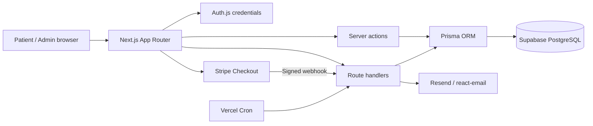
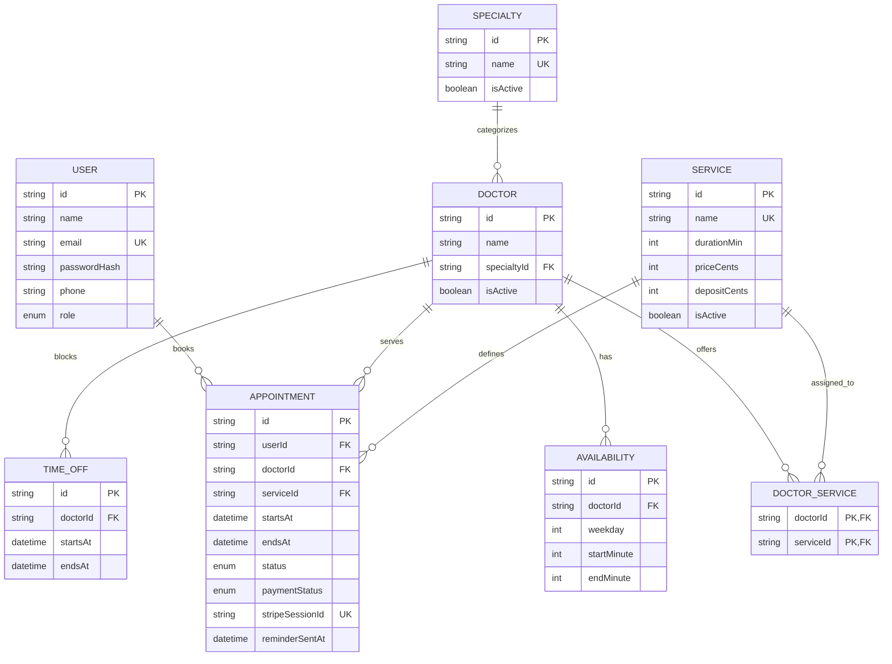

# CareSlot

CareSlot is a full-stack clinic appointment platform for discovering doctors,
booking available time slots, paying a deposit, and managing appointments from
one secure interface. Patients get a simple self-service journey; clinic staff
get a focused operational dashboard for schedules, services, doctors, patients,
payments, and reporting.

**Live demo:** [https://YOUR-LIVE-DEMO.example](https://YOUR-LIVE-DEMO.example)

## Screenshots

> Replace these placeholders with deployed application screenshots.

| Patient experience | Admin dashboard |
| --- | --- |
|  |  |

| Doctor directory | Appointment management |
| --- | --- |
|  |  |

## Demo credentials

Run `npx prisma db seed` against the demo database before using these accounts.

| Role | Email | Password |
| --- | --- | --- |
| Patient | `patient@careslot.test` | `CareSlotPatient!2026` |
| Admin | `admin@careslot.test` | `CareSlotAdmin!2026#Secure` |

Use Stripe's test card `4242 4242 4242 4242` with any future expiry, three-digit
CVC, and billing postal code.

## Features

- Browse specialties, active services, doctors, availability, and time-off.
- Search and filter the clinic catalog by specialty and doctor.
- Create and authenticate patient accounts with password-rate limiting.
- Reserve real-time appointment slots and complete a Stripe Checkout deposit.
- View, reschedule, and cancel appointments from the patient dashboard.
- Change account and password details.
- Manage doctors, specialties, services, patients, and appointments as an admin.
- Export appointment data to CSV and review revenue/reporting summaries.
- Send appointment confirmation, cancellation, refund, and reminder email.
- Automatically expire stale unpaid reservations and send due reminders.
- Protect admin and cron operations through authorization checks and secrets.

## Tech stack

| Area | Technology | Why it is used |
| --- | --- | --- |
| Application | Next.js 15 App Router, React 19 | Server-first pages and server actions keep sensitive business logic close to the UI. |
| Language | TypeScript (strict) | Shared types catch integration errors across UI, actions, API routes, and database access. |
| Styling | Tailwind CSS v4, shadcn/ui | Fast, accessible, consistent interface primitives with a small custom design layer. |
| Database | Supabase PostgreSQL, Prisma | PostgreSQL provides transactional integrity and constraints; Prisma gives typed database access. |
| Authentication | Auth.js v5, bcrypt/bcryptjs | Credential authentication, JWT sessions, password hashing, and role-aware authorization. |
| Payments | Stripe Checkout and webhooks | Stripe handles card data and checkout securely; signed webhooks synchronize payment state. |
| Email | Resend and react-email | Typed React templates and hosted delivery for transactional notifications. |
| Validation | Zod | Runtime validation for user input and server boundaries. |
| Dates | date-fns and date-fns-tz | Reliable slot generation and clinic-timezone formatting. |
| Testing | Vitest, Playwright | Fast unit coverage for slot logic plus browser-level end-to-end workflows. |
| CI and hosting | GitHub Actions, Vercel | Automated quality checks and serverless production deployment. |

## Architecture



Appointment state and database writes remain authoritative in PostgreSQL.
Next.js server actions enforce authentication and authorization; route handlers
cover Stripe webhooks and scheduled jobs; Prisma owns typed database access.

## Database ERD



## Local setup

### Prerequisites

- Node.js 20 or newer
- npm
- Supabase PostgreSQL database
- Stripe test account
- Optional Resend account
- Optional Stripe CLI for local webhook forwarding

### Installation

```bash
git clone https://github.com/abdiigashahun/A-booking-and-appointment-platform.git
cd A-booking-and-appointment-platform
npm install
cp .env.example .env.local
```

Fill `.env.local`, then generate a database client and apply migrations:

```bash
npx prisma generate
npx prisma migrate deploy
npx prisma db seed
npm run dev
```

Open `http://localhost:3000`.

### Local Stripe webhooks

In a separate terminal:

```bash
stripe listen --forward-to localhost:3000/api/stripe/webhook
```

Copy the printed webhook signing secret into `STRIPE_WEBHOOK_SECRET`.

## Environment variables

| Variable | Required | Purpose |
| --- | --- | --- |
| `DATABASE_URL` | Yes | Supabase pooled PostgreSQL connection for application queries. |
| `DIRECT_URL` | Yes | Direct PostgreSQL connection used by Prisma migrations. |
| `SUPABASE_PROJECT_ID` | Optional | Supabase project identifier for local configuration/reference. |
| `SUPABASE_DB_PASSWORD` | Optional | Database password when constructing connection strings manually. |
| `NEXT_PUBLIC_SUPABASE_URL` | Optional | Supabase public project URL. |
| `NEXT_PUBLIC_SUPABASE_PUBLISHABLE_KEY` | Optional | Supabase publishable browser key. |
| `SUPABASE_SECRET_KEY` | Optional | Supabase server-only secret key. |
| `AUTH_SECRET` | Yes | Auth.js signing/encryption secret. Generate with `openssl rand -base64 32`. |
| `AUTH_URL` | Yes | Public Auth.js origin, including protocol. |
| `NEXT_PUBLIC_APP_URL` | Yes | Public application origin used in links and redirects. |
| `STRIPE_SECRET_KEY` | Yes | Stripe server secret key. |
| `NEXT_PUBLIC_STRIPE_PUBLISHABLE_KEY` | Yes | Stripe publishable browser key. |
| `STRIPE_WEBHOOK_SECRET` | Yes | Secret used to verify signed Stripe webhook events. |
| `CRON_SECRET` | Yes | Bearer secret protecting scheduled cron route handlers. |
| `RESEND_API_KEY` | Production | Resend API key for transactional email. |
| `EMAIL_FROM` | Production | Verified sender address, for example `CareSlot <bookings@example.com>`. |
| `CLINIC_TIMEZONE` | Yes | IANA timezone for slot display and reminders; default `Africa/Addis_Ababa`. |

Never commit real credentials. `.env.local` and other `.env*` files are ignored
by Git.

## Testing

```bash
npm run test       # Vitest unit tests
npm run lint       # ESLint
npm run typecheck  # TypeScript no-emission check
npm run build      # Production Next.js build
npm run e2e        # Playwright browser tests
```

Start the application before Playwright tests, or use the Playwright
configuration's existing web server settings:

```bash
npm run dev
npx playwright install
npm run e2e
```

Vitest currently covers appointment-slot availability and stale reservation
expiry. Playwright covers signup/login, booking flow, and basic slot behavior.

## Key engineering decisions

### Double-booking prevention

Slot availability is checked in application logic, but PostgreSQL enforces the
final invariant with a partial unique index. Only `PENDING_PAYMENT` and
`CONFIRMED` appointments occupy a doctor's slot, and cancellation or completion
does not keep the slot reserved. This protects concurrent booking requests even
if application checks arrive at the same time.

### Webhook-only payment confirmation

The browser success route does not confirm payment. A signed Stripe webhook
updates the appointment to `CONFIRMED` and `PAID`, while checkout-expired,
refund, and charge failure events update the corresponding state. This avoids
trusting client redirect parameters and provides Stripe as the payment truth
source.

### UTC storage

Dates and times are stored as PostgreSQL UTC timestamps. The clinic's IANA
timezone is applied only for display and slot calculations, preventing timezone
ambiguity across server, browser, and future deployment regions.

### Idempotency

Stripe operations use the Stripe session identifier as a unique appointment
field, and webhook handlers update only the expected status transitions.
Repeated Stripe delivery or client retries therefore cannot create duplicate
appointments or change already-confirmed payment state unpredictably.
